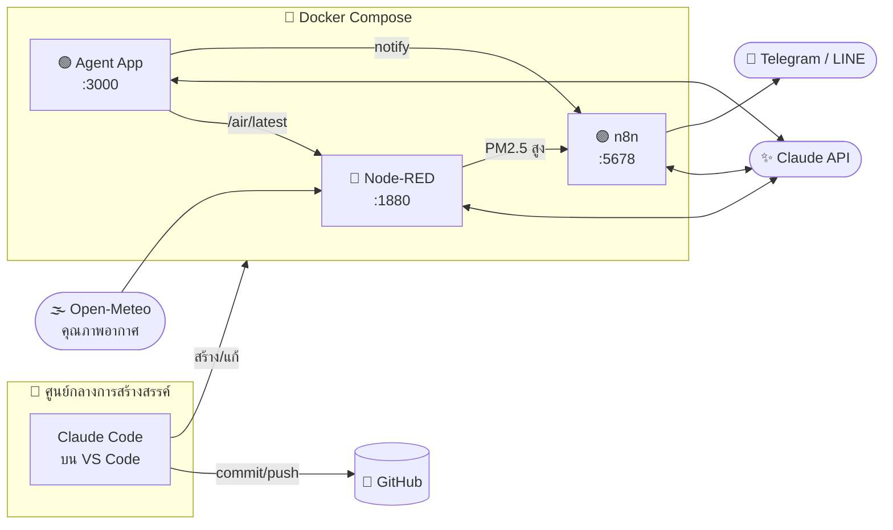

<div align="center">

# 🤖⚡ การพัฒนาระบบอัตโนมัติในยุค AI

### Workshop 1 วัน: จาก Claude Code สู่เลขาส่วนตัวและแอป AI Agent

**Advanced Enterprise AI Solution Architect Training**
อุทยานวิทยาศาสตร์ มหาวิทยาลัยขอนแก่น


<br>


📅 26–28 พฤศจิกายน 2569 · 📍 โรงแรม เดอะ ควอเตอร์ ลาดพร้าว บาย ยูเอชจี กรุงเทพฯ
🎤 วิทยากร: **นายวณัช พาดี** มหาวิทยาลัยขอนแก่น

</div>

---

## 🎯 เป้าหมายของวันนี้

ใช้ **🧠 Claude Code บน VS Code** เป็นศูนย์กลางการสร้างสรรค์ โดยมี **🐳 Docker Desktop** ทำให้ทุกอย่าง *รันได้ทุกที่* และ **🐙 GitHub Desktop** ทำให้ทุกอย่าง *ไม่หาย ส่งต่อได้* จากนั้นต่อยอดเป็นระบบอัตโนมัติ 3 ระดับ

| ระดับ | เครื่องมือ | ทำอะไรได้ |
|:---:|---|---|
| 🔴 **1** | **Node-RED** | ระบบอัตโนมัติแบบ event / IoT / งานซ้ำ ๆ ที่กติกาชัด |
| 🟣 **2** | **n8n + AI Agent** | เลขาส่วนตัว: จดงาน สรุปประจำเช้า แจ้งเตือน คุยผ่านแชท |
| 🟢 **3** | **Agent App** | แอปของเราเองที่มี AI agent เรียกเครื่องมือ (tools) ได้จริง |

### 🏆 จบวันนี้ คุณจะได้

- ✅ **Repo บน GitHub** ที่มี `CLAUDE.md` `README.md` `docker-compose.yml` ให้คนอื่น clone แล้วรันต่อได้ใน 5 นาที
- ✅ **Node-RED flow** ที่ดึงข้อมูล → ให้ Claude สรุป → แจ้งเตือนตามเวลา
- ✅ **เลขาส่วนตัวบน n8n** (AI Agent + memory + tools) ที่คุยผ่านแชทได้
- ✅ **Web app ที่มี AI agent** (Claude API + tool use) ซึ่งส่งงานต่อให้ n8n ได้

---

## 🗓️ กำหนดการ

| ⏰ เวลา | 📦 โมดูล | 📖 เนื้อหา | 🔗 เอกสาร |
|---|:---:|---|:---:|
| 08.00–08.30 | | 📝 ลงทะเบียน | |
| 08.30–09.30 | | 🎙️ พิธีเปิด | |
| 09.30–09.50 | **M0** | 🌏 ภาพรวม: การพัฒนาในยุค AI + เดโมผลลัพธ์ปลายทาง | [📘 01](docs/01-ai-native-dev.md) |
| 09.50–10.50 | **M1** | 🧠 Claude Code บน VS Code: วิธีคิด วิธีสั่ง วิธีคุม + 🧪 **Lab 1** | [📘 01](docs/01-ai-native-dev.md) |
| 10.50–12.00 | **M2** | ♻️ ความยั่งยืน: GitHub Desktop + Docker + 🧪 **Lab 2** | [📗 02](docs/02-sustainable-stack.md) |
| 12.00–13.00 | | 🍱 พักรับประทานอาหารกลางวัน | |
| 13.00–13.10 | | 🔁 ทบทวน + `docker compose up` ทั้ง stack | [🛠️ 00](docs/00-setup.md) |
| 13.10–14.00 | **M3** | 🔴 Node-RED: ระบบอัตโนมัติแบบ flow + 🧪 **Lab 3** | [📙 03](docs/03-node-red.md) |
| 14.00–15.10 | **M4** | 🟣 n8n: สร้างเลขาส่วนตัวด้วย AI Agent + 🧪 **Lab 4** | [📕 04](docs/04-n8n-secretary.md) |
| 15.10–15.20 | | ☕ พักสั้น | |
| 15.20–16.15 | **M5** | 🟢 สร้างแอปที่มี AI Agent + 🧪 **Lab 5** | [📓 05](docs/05-agent-app.md) |
| 16.15–16.30 | **M6** | 🏛️ สรุป: เลือกเครื่องมือแบบสถาปนิก + governance + ก้าวต่อไป | [📒 06](docs/06-wrap-up.md) |

> 🎤 **วิทยากร:** ดูลำดับนาทีต่อนาทีและแผนสำรองที่ [docs/instructor-runbook.md](docs/instructor-runbook.md)

---

## 🗺️ ภาพรวมระบบที่จะสร้าง



---

## 📂 โครงสร้าง repo

```text
📦 Workshop-AI-Automation-by-claude
├── 📄 README.md                  ← คุณอยู่ที่นี่
├── 🧠 CLAUDE.md                  ← "คู่มือ" ที่ Claude Code อ่านทุกครั้งที่เปิด repo นี้
├── 🐳 docker-compose.yml         ← Node-RED + n8n + Agent App ในคำสั่งเดียว
├── 🔐 .env.example               ← ตัวอย่างตัวแปร (คัดลอกเป็น .env แล้วใส่ key)
├── 📚 docs/                      ← เนื้อหาการสอนแต่ละโมดูล
├── 💬 prompts/prompt-cards.md    ← การ์ด prompt พร้อมใช้ทุก lab
├── 🧪 labs/
│   ├── 🔴 node-red/flows.json    ← flow ตัวอย่าง (import ได้ทันที)
│   └── 🟣 n8n/                   ← system prompt ของเลขาส่วนตัว
└── 🟢 apps/agent-app/            ← แอป AI Agent (Node.js + Claude API + tool use)
```

---

## 🚀 เริ่มต้นเร็ว

> ⚠️ **ทำก่อนวันอบรม** ดูรายละเอียดทั้งหมดที่ 👉 [docs/00-setup.md](docs/00-setup.md)

```bash
git clone https://github.com/nuttkku/Workshop-AI-Automation-by-claude.git
cd Workshop-AI-Automation-by-claude
cp .env.example .env          # 🔑 แล้วใส่ ANTHROPIC_API_KEY
docker compose up -d          # 🐳 เปิดทั้ง stack
```

| 🧩 บริการ | 🌐 URL | 📝 ใช้ใน |
|---|---|---|
| 🔴 Node-RED | http://localhost:1880 | Lab 3 |
| 🟣 n8n | http://localhost:5678 | Lab 4 |
| 🟢 Agent App | http://localhost:3000 | Lab 5 |

---

## 📚 สารบัญเอกสาร

| | เอกสาร | สรุป |
|:---:|---|---|
| 🛠️ | [00 · เตรียมเครื่อง](docs/00-setup.md) | ติดตั้งโปรแกรม บัญชี key และแก้ปัญหาที่พบบ่อย |
| 📘 | [01 · การพัฒนาในยุค AI](docs/01-ai-native-dev.md) | Claude Code, วงจร Explore→Plan→Build→Verify, CLAUDE.md |
| 📗 | [02 · ความยั่งยืน](docs/02-sustainable-stack.md) | Git/GitHub Desktop, Docker, Minimum Handover Kit |
| 📙 | [03 · Node-RED](docs/03-node-red.md) | ระบบอัตโนมัติ 3 ระดับ, เรียก Claude จาก flow |
| 📕 | [04 · n8n เลขาส่วนตัว](docs/04-n8n-secretary.md) | AI Agent + memory + tools, daily brief |
| 📓 | [05 · แอป AI Agent](docs/05-agent-app.md) | agent loop, tool use, guardrails |
| 📒 | [06 · สรุป](docs/06-wrap-up.md) | ตารางตัดสินใจ, governance, แผน 30 วัน |
| 💬 | [การ์ด Prompt](prompts/prompt-cards.md) | prompt พร้อมใช้ทุก lab |
| 🎤 | [Runbook วิทยากร](docs/instructor-runbook.md) | ลำดับนาทีต่อนาที + แผนสำรอง |

---

<div align="center">

💡 *"AI ทำให้การ **สร้าง** ง่ายขึ้น 10 เท่า — งานของเราคือทำให้สิ่งที่สร้าง **อยู่รอด** และ **ส่งต่อได้**"*

Made with 🧡 by Claude Code · มหาวิทยาลัยขอนแก่น

</div>
